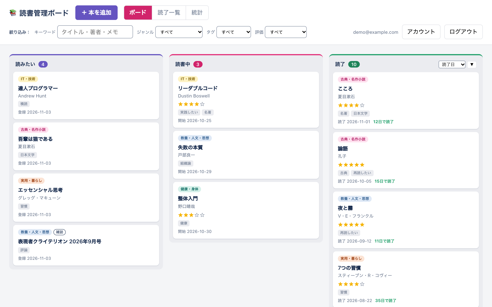
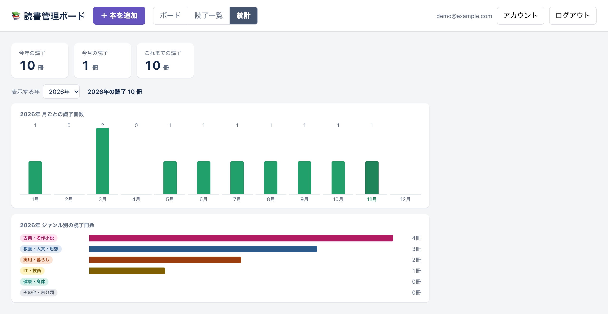
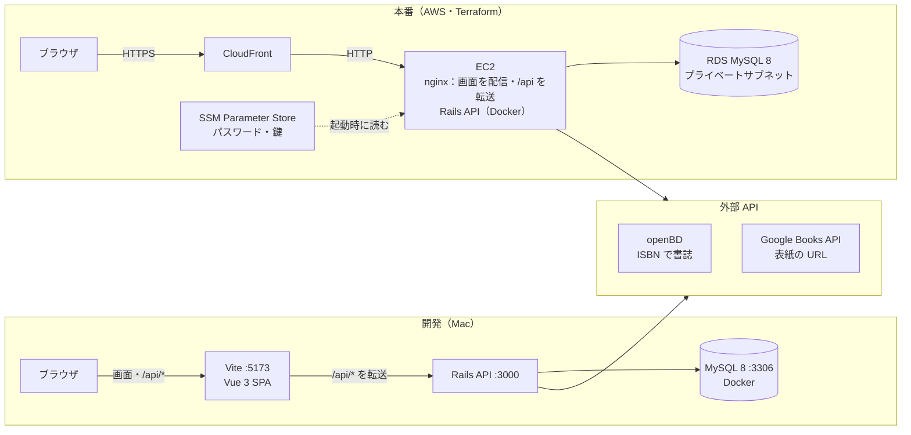

# reading-board — 読書管理アプリ（Trello 風カンバン）

読みたい / 読書中 / 読了 の 3 カラムで書籍を視覚的に管理する、Trello 風のカンバンボードアプリ。
RaiseTech の学習成果物として、**Ruby on Rails（API）+ Vue 3 + MySQL** のフルスタック構成で開発する。

## 画面

ボード：カードをドラッグして状態（読みたい・読書中・読了）を変える。上の欄でキーワード・ジャンル・タグ・評価を絞り込む。



統計：今年・今月・これまでの読了冊数と、月ごと・ジャンル別のグラフ。



（撮影用のアカウントと見本の本で撮影。表紙の画像は写していない）

## 主要機能

- 書籍の登録・表示・編集・削除（CRUD）。ISBN 入力・バーコード読取で書誌を自動入力（openBD）、表紙画像も表示（Google Books）
- カンバンのドラッグでステータス変更（読みたい ⇄ 読書中 ⇄ 読了）とカラム内の並び替え（キーボードでもカードを選んで Option ＋ 矢印キー）
- 評価（★1〜5）・感想メモ・主ジャンル・形態・タグ（候補の提案つき。アカウント画面で名前の変更・まとめる・外す）
- 各状態に入った日（日本時間）と読了までの日数の記録、読了カラムの並び替え、キーワード（タイトル・著者・メモ）・ジャンル・タグ・評価での絞り込み
- カラムごとのページング（20 件＋「もっと見る」）、読了本を 1 冊 1 行で並べる読了一覧（`/read`）
- 統計（`/stats`）：今年・今月・これまでの読了冊数、月ごと・ジャンル別のグラフ（年を切り替えられる）
- CSV 書き出し・読み込み（アカウント画面）：自分の本を CSV で保存し、CSV からまとめて登録
- 表紙のまとめて取得（アカウント画面）：ISBN があって表紙が無い本に、Google Books の表紙をまとめて付ける
- ログイン、招待制の新規登録、パスワード変更・管理者発行の再設定リンク・アカウント削除

詳細は [docs/requirements.md](docs/requirements.md) と [docs/functional-requirements.md](docs/functional-requirements.md)。

## 技術スタック

| 役割 | 技術 |
|---|---|
| バックエンド | Ruby on Rails 8（API モード）/ Ruby 3.3（mise 管理） |
| フロントエンド | Vue 3 + Vite + TypeScript（SPA） |
| データベース | MySQL 8（ローカルは Docker で起動） |
| API 通信 | REST API（JSON） |
| テスト・lint | minitest・RuboCop・Brakeman・bundler-audit / vitest・Playwright（E2E）・ESLint・Prettier |
| インフラ | AWS（EC2 ＋ RDS ＋ CloudFront）/ Terraform（[infra/README.md](infra/README.md)） |

## 構成

画面（Vue の SPA）は `/api/*` を呼ぶだけで、開発では Vite、本番では nginx が Rails に転送する。どちらもブラウザから見て同じオリジンなので、CORS の設定は要らない。



- 書誌（タイトル・著者）と表紙の URL は Rails が外部 API から取る。表紙の画像そのものは、保存した URL からブラウザが Google から読み込む
- AWS は使うときだけ作り、使い終わったら消す（データは RDS のスナップショットで引き継ぐ）。詳しくは [docs/infrastructure.md](docs/infrastructure.md)・[docs/aws-deploy-guide.md](docs/aws-deploy-guide.md)、画面遷移やデータの流れは [docs/basic-design.md](docs/basic-design.md)

## ローカル起動手順

> **ポートは厳守**: Backend **3000** / Frontend **5173** / MySQL **3306**（[CLAUDE.md §8](CLAUDE.md) 参照）

前提: mise（Ruby 3.3）・Node.js 26（CI と本番のビルドも 26）・Docker が利用できる状態。

エディタは VS Code / Cursor を想定。リポジトリを開くと右下に**おすすめの拡張機能**（Terraform・Vue・Ruby LSP・ESLint・Prettier・日本語化）の案内が出るので、インストールするとファイルが色分けされる（一覧は [.vscode/extensions.json](.vscode/extensions.json)。拡張機能画面で `@recommended` と検索しても出る）。

```bash
# 1. MySQL(Docker) を起動（Mac の中 127.0.0.1:3306 だけで待ち受ける。家以外の Wi-Fi では使い終わったら docker compose stop）
docker compose up -d

# 2. バックエンド（Rails API, :3000）
cd backend
bundle install                           # 初回と、Gemfile が変わったとき（Ruby の部品を入れる）
bin/rails db:create db:migrate db:seed   # 初回のみ（seed で初期ユーザー＝管理者とデモ用の本を作成）
bin/rails server

# 3. フロントエンド（Vite, :5173）※別ターミナル
cd frontend
npm install                      # 初回のみ
npm run dev
```

ブラウザで `http://localhost:5173` を開き、seed の初期ユーザー `owner@example.com` / `ReadingBoard-dev-2026!` でログインする（`SEED_USER_EMAIL` / `SEED_USER_PASSWORD` で変更可）。`/api/*` は Vite プロキシ経由で Rails(3000) に転送される。

### 書影（表紙画像）を開発で出すとき（任意）

表紙は Google Books から取得する。API キー（`GOOGLE_BOOKS_API_KEY`）が無くてもアプリは動く（表紙が出ないだけ）。
毎回鍵を入れなくて済むよう、Git に入らない mise の個人用設定（`backend/mise.local.toml`）に置く。

1 の `read -s` の行は、**1 行まるごと貼り付けて Enter** を押す（鍵はまだ貼らない）。「鍵を貼り付けて Enter（画面には表示されません）:」と出てから、鍵を貼り付けて Enter を押す。`read -s` の後ろに鍵を書くと、鍵が画面と入力の記録に残ってしまう。
3 の `cd backend` で、信頼する前の設定ファイルについて `mise ERROR … are not trusted` と出ることがあるが、続く `mise trust` で `mise trusted …` と出れば問題ない。

```bash
# 1. 鍵を画面に出さずに読み込む（この行を貼って Enter → 案内が出たら、Google Cloud の「認証情報」でコピーした鍵を貼り付けて Enter）
read -s "GOOGLE_BOOKS_API_KEY?鍵を貼り付けて Enter（画面には表示されません）: " && export GOOGLE_BOOKS_API_KEY && echo ""
# 2. mise の個人用設定に書く（.gitignore 済み）
printf '[env]\nGOOGLE_BOOKS_API_KEY = "%s"\n' "$GOOGLE_BOOKS_API_KEY" > backend/mise.local.toml
# 3. 初回だけ、この設定ファイルを信頼する（mise の決まり）
cd backend && mise trust mise.local.toml
# 4. Rails を起動し直す（起動中なら Ctrl+C で止めてから）
bin/rails server
```

本番（AWS）の鍵の置き方は [AWS 手順書](docs/aws-deploy-guide.md) の 5.6。

## テスト・チェック

```bash
cd backend && bin/rails test     # Rails（minitest）
cd backend && bin/rubocop        # Ruby の書き方チェック（rubocop-rails-omakase）
cd backend && bin/brakeman       # Rails のセキュリティ検査
cd backend && bin/bundler-audit  # gem の脆弱性検査
cd frontend && npm test          # Vue/TS（vitest）
cd frontend && npm run lint      # 書き方チェック（ESLint）
cd frontend && npm run format    # 見た目の自動整形（Prettier）。確認だけなら npm run format:check
```

CI（GitHub Actions）で PR ごとに上記すべてと `npm run build`・Terraform の fmt / validate・下の E2E テストを実行する（ジョブは 5 つ）。backend はまとめて `bin/ci` でも実行できる。

### E2E テスト（Playwright）

本物のブラウザ（入っている Chrome）で、本物のアプリ（Vite → Rails → MySQL）を人と同じように操作して確かめる。確かめる流れは、ログインとログアウト・本の追加 / 編集 / 削除・カードの移動（ドラッグ・Option ＋ 矢印キー）・絞り込み・読了一覧・統計・CSV の書き出しと読み込み。テストは `frontend/e2e/`。

```bash
# 先に上の「ローカル起動手順」で MySQL・Rails（3000）・Vite（5173）を起動しておく
cd frontend && npm run test:e2e
```

- E2E 専用のアカウント `e2e@example.com` を始める前に作り直し、終わったら本ごと消す（開発用 DB のほかのアカウントには触れない）
- ログインは 3 分に 10 回までの制限があり、1 回流すとログインを 3 回使う。**続けて流すのは 3 分に 3 回まで**（当たったら「ログインの回数制限に当たりました」で止まる。3 分待つか、Rails を起動し直す）
- 失敗したときは `frontend/test-results/` に画面の写真と操作の記録が残る。記録は `npx playwright show-trace <trace.zip>` で開ける
- CI でも PR ごとに流れる（ジョブ「E2E (Playwright)」。CI の機械の中で MySQL・Rails・Vite を起動する）。失敗したら、PR の Checks →「Summary」の Artifacts にある `e2e-results`（写真・記録・Rails と Vite のログ）を落として見る

## ディレクトリ構成

```
reading-board/
├── backend/            Rails API（Ruby 3.3 / MySQL）
├── frontend/           Vue 3 + Vite + TypeScript
├── infra/              AWS の Terraform（使うときだけ起動）
├── docs/               設計・要件定義ドキュメント
├── prototype/          画面イメージのモック（HTML/CSS/JS）
├── docker-compose.yml  MySQL 8 のローカル起動設定
├── CLAUDE.md           開発ルール（Issue→Branch→PR / ポート規約）
└── README.md
```

## 開発ワークフロー

**Issue → Branch → PR → セルフマージ → Branch 削除** を厳守（詳細は [CLAUDE.md](CLAUDE.md)）。
